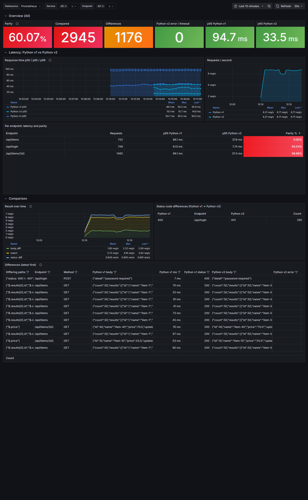

# request-mirroring — Claude Code skill

> 🇺🇿 **O'zbekcha oddiy tushuntirish:** [QOLLANMA.md](QOLLANMA.md)

Safely replace **any HTTP backend, in any language** — Python → Python (v1 → v2), Python → Go, Node → Go, framework or runtime upgrades, monolith → service — by mirroring **real production traffic** to the new implementation and comparing every response, without the new one ever answering a user or touching production data. Results (parity %, every differing response, latency and RAM/CPU of both) are shown in **Grafana**.

```
client ─► nginx ─► shadow proxy ──► PRIMARY (old)   → answers the client
             │            └─ copy ─► SHADOW (new)    → only compared, own DB copy + fake external APIs
             └─ proxy down → nginx backup → PRIMARY
```

What you get: parity % per endpoint, a list of every differing response (both bodies side by side), p50/p95/p99 of both, RAM/CPU of both — in Prometheus/Grafana — plus one command to switch the mirror on or off.

Only the tooling (the comparing proxy and metrics exporter) is written in Go and ships as Docker images built from `tool/`; the services being compared can be anything that speaks HTTP.

Built and used for a real migration of three production services; the bundled demo compares two Python versions.

## Try the demo (2 minutes)

```bash
cd example && docker compose up -d --build
# Grafana: http://127.0.0.1:3000 (admin / admin) → Dashboards → Mirror → "Demo: Python v1 vs Python v2"
# raw diffs: http://127.0.0.1:9187/diffs
docker compose down -v
```



## Install

```bash
# personal skill (all projects)
git clone https://github.com/Abduqodir7007/request-mirroring.git ~/.claude/skills/request-mirroring

# or project skill (this repo only)
git clone https://github.com/Abduqodir7007/request-mirroring.git .claude/skills/request-mirroring
```

Update later with `git -C ~/.claude/skills/request-mirroring pull`.

Then just ask Claude Code something like *"set up request mirroring from orders-api v1 to v2 and show it in Grafana"* — the skill loads automatically (or type `/request-mirroring`).

## Contents

| path | |
|---|---|
| `SKILL.md` | entry point for Claude: rules, procedure, how to read results |
| `references/architecture.md` | proxy internals, comparison, metrics, settings, fake APIs |
| `references/rollout-runbook.md` | phase 0–7 + cutover, with commands |
| `references/shadow-data.md` | shadow DB / Redis / network, periodic refresh |
| `references/grafana.md` | getting the results into an existing Grafana or the bundled stack |
| `references/pitfalls.md` | real mistakes and how to avoid them |
| `example/` | runnable demo: Python v1 vs v2 + proxy + Prometheus + Grafana |
| `templates/` | compose files, nginx configs, switch/check/refresh scripts, Prometheus+Grafana stack, dashboard generator and importer |
| `tool/` | Go source of `proxy`, `fakeapi`, `cgstats` (stdlib only, tests included) |

## Build the tool images

```bash
cd tool
docker build --target proxy  -t shadow_proxy:latest .
docker build --target fakeapi -t shadow_fakeapi:latest .
go test ./...
```

---

## O'zbekcha qisqacha

Bu skill istalgan tildagi HTTP servisni yangisiga (Python → Python v2, Python → Go, Node → Go va h.k.) xavfsiz almashtirish uchun. Faqat solishtiruvchi proksi va metrikalar Go'da yozilgan, natija Grafana'da ko'rinadi. Prod'dagi har bir so'rovning nusxasi yangi servisga ham yuboriladi va javoblar solishtiriladi. Mijoz esa doim eski servis javobini oladi. Yangi servis bazaning alohida nusxasi va soxta tashqi API'lar (Telegram, AI, webhook) bilan ishlaydi, shuning uchun hech kimga xabar yubormaydi va prod bazaga yozmaydi.

O'rnatish: yuqoridagi `git clone` buyrug'i bilan `~/.claude/skills/request-mirroring` ga yuklab oling. Keyin Claude Code'ga "orders-api v1 dan v2 ga request mirroring sozla va Grafana'da ko'rsat" deb yozsangiz bo'ladi. Demo: `cd example && docker compose up -d --build`, so'ng http://127.0.0.1:3000 (admin/admin). Yangilash: `git -C ~/.claude/skills/request-mirroring pull`.

## License

MIT
